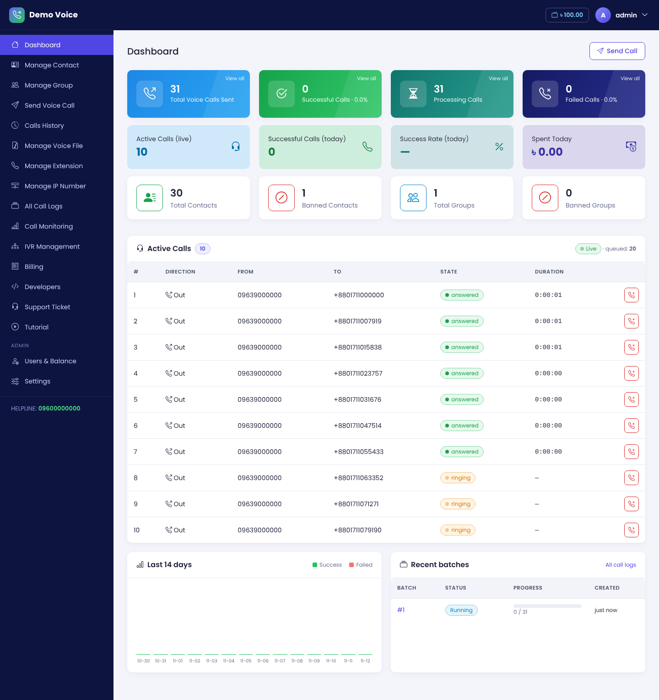
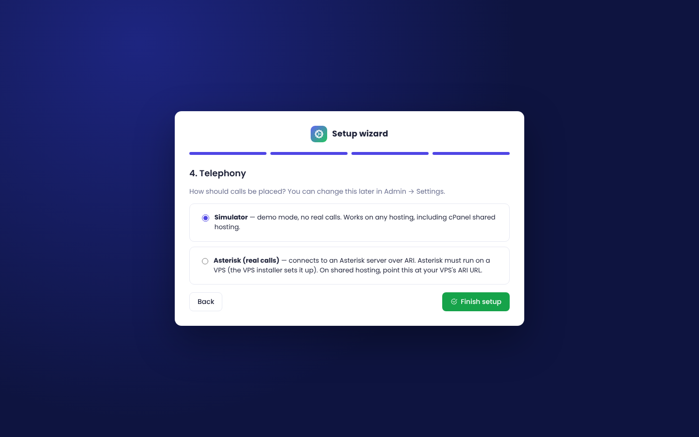
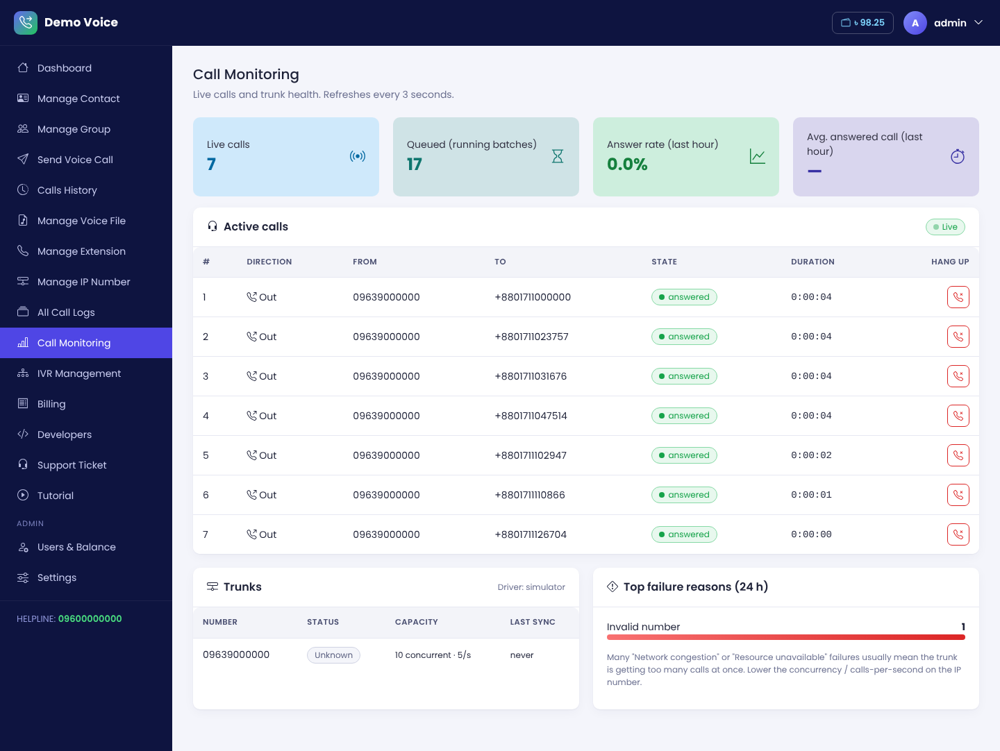

# IP Call Panel

A self-hosted **voice broadcast and IP telephony panel**: upload a recorded message, pick contacts or groups, and the panel calls everyone through your SIP trunk (IP number). It has live monitoring, IVR menus with key-press (DTMF) capture, agent extensions, a prepaid wallet with per-pulse billing, a REST API, support tickets and an admin area.

It runs on **cPanel shared hosting** (no root) and on a **VPS** (root), and has a **setup wizard** that runs on first launch.



| Page | What it does |
|---|---|
| Dashboard | Totals, today's stats, live active calls, 14-day chart, recent batches |
| Manage Contact / Group | CRUD, CSV import/export, bulk actions, ban numbers or whole groups |
| Send Voice Call | Paste numbers, upload CSV or pick groups; voice file or IVR; retries; scheduling |
| Calls History | Filters (mobile, batch, status, direction, date, sender), stats, CSV export, per-call detail |
| All Call Logs | Every batch with progress, pause / resume / cancel |
| Call Monitoring | Live calls (hang up from the panel), trunk health, answer rate, top failure reasons |
| Manage Voice File | Upload MP3/WAV, preview, auto-convert for Asterisk |
| Manage Extension | SIP accounts for agents, password reveal/copy/reset, softphone downloads |
| Manage IP Number | SIP trunks with per-trunk concurrency and calls-per-second limits |
| IVR Management | Welcome voice, music on hold, IVR menus (play file / transfer to extension / forward to mobile / repeat / hang up) |
| Billing | Wallet, rate, pulse, transaction ledger |
| Developers | API key and REST docs (cURL + PHP examples) |
| Support Ticket | User ↔ admin threads |
| Admin | Users, top-ups, rates, impersonation, site and telephony settings, cron URL, generated Asterisk config |

## How it works

```
 Browser ──► Node.js panel (Express + SQLite) ──► Call engine ──► driver
                                                       │            ├─ simulator  (demo, any hosting)
                                                       │            └─ asterisk   (ARI → PJSIP trunk → phone network)
                                                       └─ concurrency + calls/second per trunk, retries, billing
```

* **Simulator** produces realistic outcomes (answered, busy, no answer, congestion, DTMF) so you can demo and train without a trunk.
* **Asterisk** mode originates `PJSIP/<number>@trunk<ID>` into the Stasis app, plays the message or IVR, records DTMF, and bridges transfers. Inbound calls to your IP number run the Welcome Voice + IVR settings. The panel writes the PJSIP config for trunks and extensions and reloads Asterisk.

---

## Option A: VPS (recommended for real calls)

Ubuntu 22.04/24.04 or Debian 12, at least 1 vCPU / 1 GB RAM, public IP. Run as root:

```bash
git clone https://github.com/eusofali/IP-Call.git && cd IP-Call
sudo bash install/vps-install.sh --domain panel.example.com --email you@example.com
```

The installer sets up Node.js 22, ffmpeg, Asterisk (PJSIP, ARI on localhost, chan_sip disabled), the panel as a `systemd` service, nginx, the UFW firewall (SSH, 80/443, SIP 5060, RTP 10000–20000/udp) and a Let's Encrypt certificate. Then open the URL; the wizard already has the Asterisk details filled in.

Options: `--no-asterisk` (panel only), `--expose-ari` (lets a panel on cPanel use this server's Asterisk over HTTPS), `--port 3000`.

```bash
systemctl status ip-call
journalctl -u ip-call -f
asterisk -rvvv
```

**Update:** pull the new code and run the same installer command again. `.env` and `data/` are kept.

## Option B: cPanel shared hosting (no root)

Requires a host whose cPanel has **Setup Node.js App** (CloudLinux / Passenger). Shared hosting **cannot run Asterisk**, so use the simulator, or Option C for real calls.

1. Upload the files (or use *Git Version Control*) to a folder **outside** `public_html`, e.g. `~/ip-call`.
2. cPanel → **Setup Node.js App** → *Create Application*: Node.js **22** (minimum 18), Application root `ip-call`, your domain/subdomain, startup file **`app.js`**. Click *Create*.
3. Copy the `source …/activate` command shown at the top, open cPanel → **Terminal**, paste it, then:
   ```bash
   cd ~/ip-call && bash install/cpanel-setup.sh
   ```
   (Or click **Run NPM Install** in the Node.js App page.) If the host can't compile `better-sqlite3`, the panel falls back to Node's built-in SQLite automatically (Node 22.5+).
4. Click **Restart** in Setup Node.js App and open your URL → the setup wizard runs.
5. **Important:** cPanel puts idle Node apps to sleep, which pauses queued calls. In *Admin → Settings*, copy the cron command and add it in cPanel → **Cron Jobs**, set to run *every minute*.

## Option C: panel on cPanel + Asterisk on a VPS

1. On the VPS: `sudo bash install/vps-install.sh --domain pbx.example.com --expose-ari`
2. On cPanel, follow Option B. In the wizard choose **Asterisk**, ARI URL `https://pbx.example.com`, user `ipcall`, password from `/opt/ip-call/.env` on the VPS. Leave *Sounds folder* and *PJSIP file* empty.
3. In *Admin → Settings → Generated Asterisk PJSIP config*, copy the config to `/etc/asterisk/pjsip_ipcall.conf` on the VPS after adding trunks/extensions, then `asterisk -rx "module reload res_pjsip.so"`.
4. Voice files are fetched by Asterisk from the panel through signed URLs (`/media/...`). Upload **WAV 8 kHz mono** if the host has no ffmpeg.

| Setup wizard | Call monitoring |
|---|---|
|  |  |

## Local development

```bash
npm install
npm run dev            # http://localhost:3000 → wizard
npm test               # unit + API tests (simulator)
```

---

## REST API

`Authorization: Bearer <API key>` (Developers page). Base `https://your-panel/api/v1`.

```bash
curl -X POST https://your-panel/api/v1/calls \
  -H "Authorization: Bearer KEY" -H "Content-Type: application/json" \
  -d '{"numbers":["01712345678","01812345678"],"voice_file_id":1}'
# {"batch_id":12,"queued":2,"invalid":0,"skipped_banned":0,"scheduled":false}
```

Endpoints: `POST /calls`, `GET /calls`, `GET /calls/{id}`, `GET /batches/{id}`, `POST /batches/{id}/pause|resume|cancel`, `GET /voice-files`, `GET /ip-numbers`, `GET /balance`.

## Billing model

Each user has a **rate per minute** and a **pulse** (e.g. 60 s = per-minute billing, 1 s = per-second). Only answered calls are charged, rounded up to the pulse. A batch pauses itself with "Insufficient balance" when the wallet can't cover the next call, and resumes automatically when an admin tops up.

## Operations notes

* **Back up `data/`.** It holds the SQLite database and uploaded voice files.
* SIP trunk and extension passwords are stored in the database in plain text, because Asterisk needs them to register. Protect the server and the backups.
* Start trunks with **low concurrency and 1–2 calls per second**. Operators reject bursts, which shows up as "Network congestion" / "Resource unavailable" in *Call Monitoring*.
* Voice broadcasting is regulated (for example by BTRC in Bangladesh). Only call people who agreed to be contacted, and honour opt-outs with the *Ban* feature.

## Project layout

```
server.js / app.js        entry points (node / Passenger)
src/app.js                Express setup, sessions, CSRF, install guard
src/engine.js             dialer: queue, limits, retries, billing
src/drivers/              simulator.js, asterisk.js (ARI)
src/services/             batches, billing, media, asterisk-config
src/routes/               install wizard, panel, telephony, account, admin, api
views/                    EJS templates     public/  CSS + JS
asterisk/                 base Asterisk configs used by the VPS installer
install/                  vps-install.sh, cpanel-setup.sh
test/                     node:test suites
```
